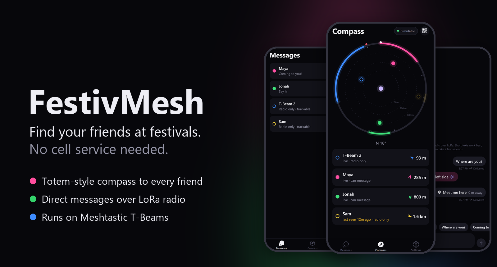
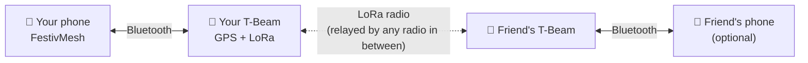
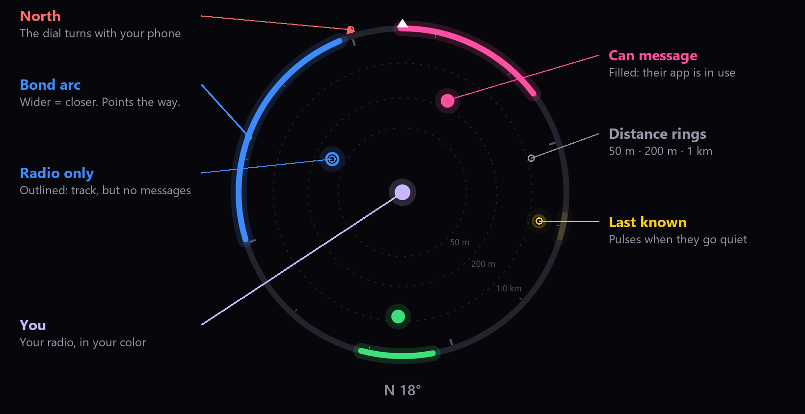
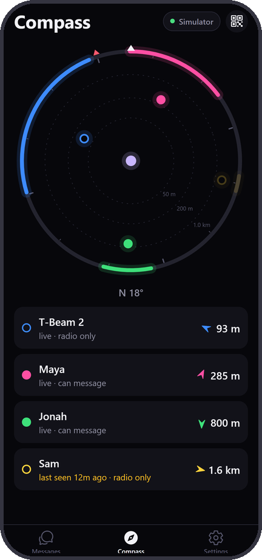
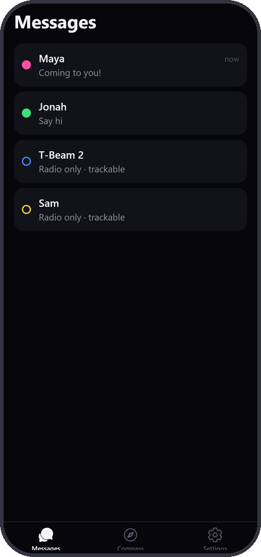
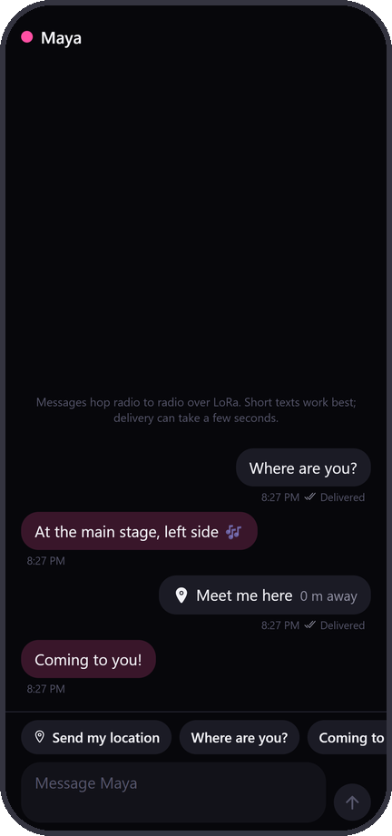
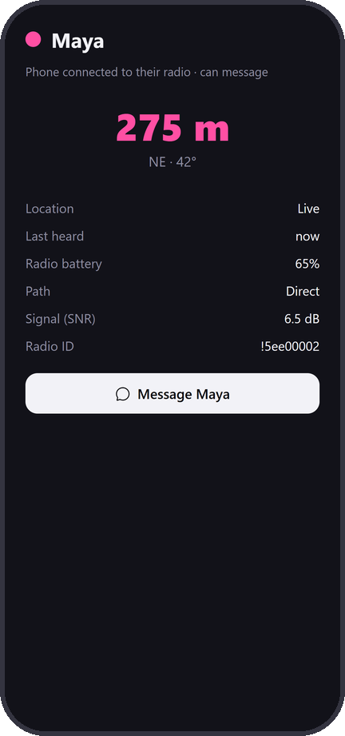
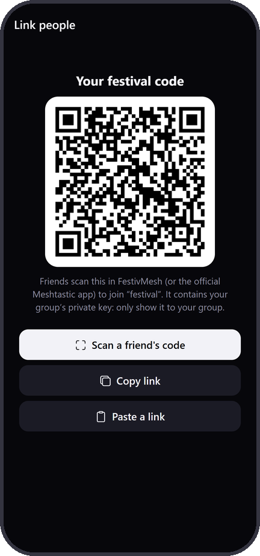
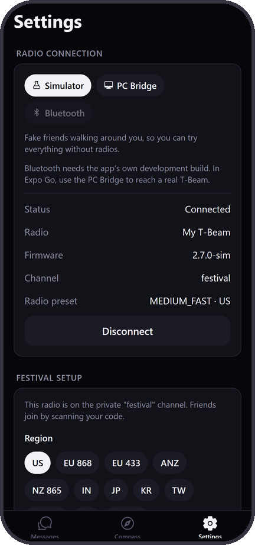

<p align="center">
  
</p>

<p align="center">
  
  
  
  
</p>

FestivMesh finds your friends at festivals when the phone network is down. Everyone carries a small [Meshtastic](https://meshtastic.org) radio (a LILYGO T-Beam or similar). The radios pass positions and messages to each other over LoRa, kilometers at a time, and the app turns that into a compass that points at each friend.

## How it works



- **Positions** come from each T-Beam's own GPS, so a friend shows up on your compass even when their phone is dead, locked, or left in the tent.
- **Messages** go phone → radio → mesh → radio → phone. If your friend's phone isn't connected, the message waits on their radio until they open the app.
- **Nothing goes through a server.** Your group shares a private channel key by QR code; only radios with that key can read your positions and messages.

## Reading the compass

<p align="center">
  
</p>

Inspired by the [Totem compass](https://totemlabs.com/pages/how-it-works). Each friend gets a color (up to 8).

| What you see | What it means |
|---|---|
| **Bond arc** on the outer ring | Points toward the friend. Wider means closer: a sliver beyond 1.5 km, about a third of the ring within 25 m. |
| **Filled dot** | They use the app, so you can message them. If their phone is locked it says "phone away" and the message waits on their radio. |
| **Outlined dot** | Radio only: you can track them but not message them. |
| **Slowly pulsing** | Last known position. Starts after about three missed updates: ~90 s for someone walking, 5 min for someone standing still. |
| **Their color around your dot** | They're within 15 m. You found them. |

Turn until a friend's arc is at the top: the phone gives a little tap and shows "Maya · 285 m ahead".

## Screens

<table>
  <tr>
    <td align="center" width="33%"><br><b>Compass</b><br>Every friend's direction and distance.</td>
    <td align="center" width="33%"><br><b>Messages</b><br>One chat per friend, with unread badges.</td>
    <td align="center" width="33%"><br><b>Chat</b><br>Quick replies and "Send my location". Ticks show <i>on the mesh</i> → <i>delivered</i>.</td>
  </tr>
  <tr>
    <td align="center"><br><b>Friend</b><br>Distance, last heard, radio battery and signal.</td>
    <td align="center"><br><b>Link people</b><br>Share your group's channel as a QR code.</td>
    <td align="center"><br><b>Settings</b><br>Radio connection, festival setup, your name and color.</td>
  </tr>
</table>

New messages raise an alert and badge the app icon; tapping the alert opens the chat. A shared location shows up as a meeting point on your friend's compass.

## Festival setup

Do this once at home, with every radio.

1. Connect your radio, then **Settings › Festival setup** › pick your region and preset › **Set up this radio**. This creates a private channel with full-precision GPS. The public default channel blurs positions to about 1 km, which is useless for finding people.
2. On each friend's phone, tap the **QR button** on the compass and scan your code. For a second radio of your own, plug it in and use **Paste a link**.

All radios must share the channel and the preset.

<details>
<summary><b>What the setup changes on the radio</b></summary>

| Setting | Value | Why |
|---|---|---|
| Primary channel | `festival`, random 256-bit key | Private: strangers can't see your group |
| Position precision | 32 bits | Exact positions instead of a ~1 km blur |
| Smart position broadcast | after 10 m of movement, at most every 15 s | Walking friends stay live |
| Position broadcast | every 2 min | Standing still costs little airtime |
| GPS update | every 10 s | Positions are never more than ~15 m stale at walking pace |
| LoRa preset | Medium Fast (selectable) | Less airtime in crowded festival meshes |

The radio restarts to apply these (about 15 seconds).
</details>

**Who becomes a friend:** radios on your private channel are added automatically, up to 8. Radios on the public default channel aren't, so strangers nearby can't fill your compass; add them under **Settings › Nearby radios**. Anyone who messages you is added.

## Run it

```bash
npm install
npx expo start          # scan the QR code with Expo Go (SDK 58)
```

It starts in **Simulator** mode with four fake friends walking around you, so you can try everything without radios.

### A real T-Beam from Expo Go (PC bridge)

Expo Go can't use Bluetooth, so your PC forwards a USB-connected T-Beam to the phone over WiFi:

```bash
npm run probe           # check the radio answers (firmware, nodes, channel)
npm run bridge          # serves ws://<pc-ip>:8787 (add --port COM6 to pick a port, --verbose for logs)
npm run diagnose        # health check: power chip, battery, GPS, mesh (add --reset for the full boot log)
```

Close anything else using the radio's serial port first (the Meshtastic web or desktop app, a serial monitor). In the app, go to **Settings › PC Bridge** and enter the address the bridge printed. The phone and PC must be on the same WiFi.

### Bluetooth (development build)

Bluetooth is built in (`src/mesh/bleTransport.ts`) but needs the app's own build instead of Expo Go: `npx eas-cli@latest build --profile development --platform ios` (needs an Apple Developer account), or Android with `npx expo run:android`.

What keeps working with the phone locked depends on the build, because iOS pauses apps in the background:

| | Expo Go + PC bridge | Bluetooth build |
|---|---|---|
| Friends see where you are | ✅ from your radio's GPS | ✅ |
| Friends can message you | ✅ it waits on your radio | ✅ |
| Alerts for new messages | ❌ only while the app is open | ✅ while iOS keeps the app in memory (not yet tested on a device) |
| App swiped away | Radio keeps working; messages wait until you open the app | Same |

## Battery

- **Phone:** the screen only stays awake while the compass is on screen. The compass sensor and animations stop on other tabs. GPS updates after 2 m of movement. Saves to storage are batched.
- **Radio:** position updates follow movement (see the setup table). Stationary radios send once every 2 minutes. If your radio's battery dies, the app retries with growing gaps instead of every few seconds.

## Project layout

| Path | What's there |
|---|---|
| `src/app/` | Screens ([Expo Router](https://docs.expo.dev/router/introduction/)) |
| `src/compass/` | The dial and its geometry |
| `src/mesh/` | Meshtastic protocol, `MeshClient`, and transports: simulator, PC bridge, Bluetooth |
| `src/store/` | App state, saved on the phone |
| `bridge/` | USB serial ↔ WebSocket bridge and the radio health check |
| `tests/` | Run with `npm test` |

`tests/festival.test.ts` acts out festival situations against a fake radio: a phone dying mid-send, the app swiped away, a radio walking out of range or running out of battery, a friend's phone locking, strangers on the public channel.
